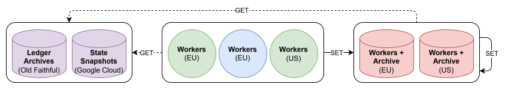
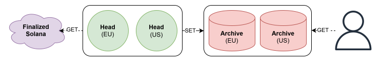

# Solana historical-state research

A small research companion to [SVM Replay](https://github.com/xternet/svm-replay)
and [Txlab](https://txlab.co): how to retain and query Solana's historical state,
not just its transaction records.

**Status: research prototype, not a production historical RPC service.**
The repository contains an offline account-history example and sanitized results
from larger local experiments. The example does not initialize Agave, execute
transactions or reproduce the larger benchmarks.

## Start here

| Read | What it answers |
|---|---|
| [Latest audit](docs/audit-update.md) | Updated storage candidates, load/cold measurements and implementation gates |
| [Benchmarks](docs/benchmarks.md) | STORAGE, GET and SET tables; measured versus projected values |
| [Test hardware](docs/test-environment.md) | Actual CPU, RAM, disks, worker limits and cache conditions |
| [Architecture](docs/architecture.md) | Snapshots, archived blocks, per-change capture, indexes and serving |
| [2027 capacity plan](docs/capacity-plan.md) | Two complete EU/US copies, calendar growth and traffic limits |
| [Architecture figures](docs/diagrams/README.md) | Backfill and continuous capture; editable draw.io PNGs |
| [Tool integrations](docs/integrations.md) | SVM Replay 0.2.0 and submitted Surfpool, Studio, Anchor and documentation PRs |
| [Data contract](docs/data-contract.md) | What must be retained and which gaps remain |
| [RPC scope](docs/rpc-scope.md) | The planned historical query surface and exact counting rules |
| [Reproduction](docs/reproduction.md) | Run the small example and regenerate the tables |
| [Research tools](docs/research-tools.md) | Included scripts, their origins and what needs external inputs |

## Run the offline example

Requirements: Linux/WSL2, Python 3.12+ and the Zstandard shared library (`libzstd`).
On Debian/Ubuntu the library is supplied by `libzstd1`.
No Python packages, API keys, RPC calls or network access are required.

```bash
python3 -m unittest discover -s tests -v
python3 -m history_poc --fixture fixtures/account_changes.json --output out/demo
python3 tools/render_report.py --check
python3 -m tools.benchmark --fixture fixtures/account_changes.json
```

The example uses an account-change extract from a private local mainnet replay
capture. Source-file hashes are retained, but its on-chain provenance is not
independently verifiable from this folder alone. It writes full
anchors plus directly referenced byte patches, compresses a bounded segment,
and resolves historical states by account and transaction boundary. Every stored
version is checked against an independent scan of the original fixture before
publishing the manifest. Manifest, payload and index checksums detect corruption.
The output directory must be new; existing results are never overwritten.

This is **account-state reconstruction, not SVM execution**. Real performance
results are in the benchmark document, with their own sample sizes and limits.
The example's timings must not be substituted for those measurements.

The separate [pointer-index example](history_poc/version_index.py) preserves
shard identity and full cursor ordering. Its tests compare lookups with a
brute-force scan, including cross-archive predecessors. It is not a network router.
The [codec tool](tools/benchmark.py) measures actual compressed bytes, directories
and exact round trips on bounded local inputs; its tiny-fixture ratios are not
historical storage estimates.

## Proposed backend

### Backfill

<p align="center">
  
  <br />
  <sub>Figure 1 — Historical backfill</sub>
</p>

<p align="center"><sub>All workers fetch inputs and write verified output directly to both archives.</sub></p>

### After backfill

<p align="center">
  
  <br />
  <sub>Figure 2 — Continuous sync and historical access</sub>
</p>

<p align="center"><sub>Independent heads update both archives; users read through the API or download service.</sub></p>

[Backfill and after-backfill views](docs/diagrams/README.md).
These figures describe the planned production backend, not the small offline demo.
The blue EU workers are our cluster; green EU/US workers temporarily use the head
servers. Both red archive hosts also run qualified workers. GET arrows show
requests, not response direction; SET writes to both archives, not EU-to-US forwarding.

The selected design uses immutable compressed history, bounded RocksDB ingestion
overlays, PostgreSQL service metadata, HDD capacity and bounded NVMe/RAM caches.
The choice is based on small local comparisons, not a universal database ranking.
The updated plan uses one complete Dataforest copy in Frankfurt and one complete
BudgetVM replica in Detroit, plus TeraSwitch heads in Frankfurt and Newark. Spare
head compute first helps backfill; heads switch to capture before the final join.
Qualified compute on both storage hosts also helps. Each producer
writes directly to both copies; neither site is a mandatory relay for the other.
These remain planned deployments, not currently operating services.
The [planned-machine table](docs/architecture.md#planned-machines) lists CPU,
RAM, drives and the worker-allocation policy for all four rented hosts.
WebNX Ogden remains an unbudgeted US fallback. Shared TeraSwitch head-provider
risk is accepted; the two full archives retain independent storage providers.

Planned free access is built into SVM Replay, supported Surfpool/Anchor workflows
and the Txlab replay UI, without developers supplying an API key. Published
quotas and abuse controls apply; this is not a currently deployed service.

## What this does not prove

* Complete state capture across every runtime era or epoch transition.
* A final bound on storage or a production latency/backfill SLA.
* Complete program/token discovery from the included account subset.
* A trustless consensus proof for an arbitrary account.
* That no other organization possesses historical state privately.

Native-context correction and complete bootstrap discovery-index sizing remain
explicitly unresolved. See the [data contract](docs/data-contract.md).

## Evidence and licensing

[Sanitized results](data/results.json) preserve sample counts, measurements,
projection inputs and source-artifact hashes. Private paths, credentials, grant
budgets, provider-response logs and complete raw source captures are not included.
Checksums bind files; they do not independently prove the original experiment.
The [October 20 evidence](data/audit-20261020.json) adds the subsequent audit
without rewriting earlier measurements as if they had been rerun.

Code and documentation: [Apache-2.0](LICENSE). The fixture is exported from a
private capture of public-chain data; see [fixture provenance](fixtures/README.md).
