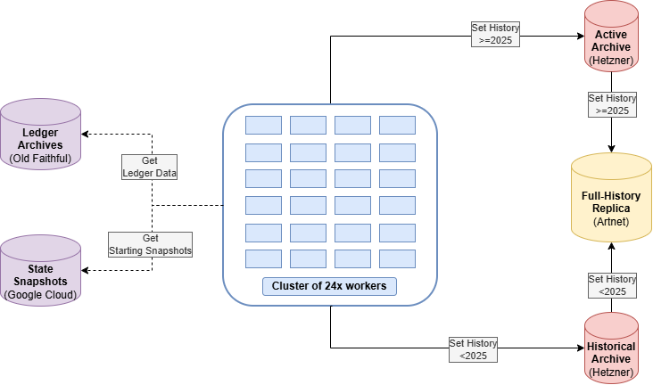
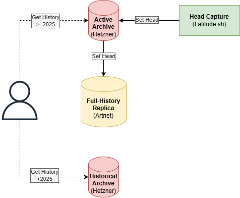

# Architecture

[Back to overview](../README.md)

## Goal

Provide historical account state and execution inputs from genesis to the latest
finalized block. This is the **planned production scope**, not current coverage
of the repository's demonstration.

Transaction archives preserve what transactions and blocks contain. Reconstructing
account state also requires a starting state, correctly matched execution rules,
automatic updates and the context needed at the requested transaction boundary.

## Backfill

  
   
  Figure 1 — Historical backfill

The Historical Archive holds genesis through a verified capacity cutoff; the
Active Archive holds later history and appends finalized head data. The diagrams'
2025 split is illustrative, not a fixed production cutoff. These are different
history shards; Artnet retains an independent copy of both. The API/replay coordinator is
co-located on the storage hosts; PostgreSQL service metadata/jobs and bounded
RocksDB ingestion overlays do not form a third historical payload archive.
Consistent checkpoint/metadata exports are replicated, not live database files.

Temporary workers replay independent ranges from qualified starting checkpoints.
The owned non-voting head node captures native effects and finalization; it is
not merely a third-party RPC subscription. Server density, starting checkpoints
and capture completeness still require qualification.

## After backfill

  
   
  Figure 2 — Continuous sync and historical access

Temporary workers are retired after catch-up. Head Capture sets finalized data
on the Active Archive; after verification, the Active Archive sets the replica.
The Historical Archive's existing copy remains on the replica. RPCs may need
account versions from either shard, regardless of the requested date.
Verified ranges can also serve RPCs during backfill. Head capture starts before
the final backfill/live-state join.

## Build once, query many times

| Stage | Work | Output |
|---|---|---|
| Bootstrap | Verify genesis/snapshot identity and complete starting account inventory | Trusted state and native restart prerequisites |
| Import | Read archived ledger inputs and original metadata | Ordered, source-identified transactions and blocks |
| Execute | Use matching Solana/Agave runtimes; capture committed and automatic updates | Account changes and native context at defined boundaries |
| Pack | Deduplicate shared values; encode anchors/patches; compress and seal segments | Immutable history with compact temporal indexes |
| Serve | Resolve signature/cursor and predecessor versions; read bounded frames | Historical state or complete execution inputs |
| Maintain | Ingest finalized head, replicate, monitor and recover | Current, checked coverage |

Snapshots alone do not reveal all changes between them. The archived ledger is
executed once during ingestion to recover those changes. Later account-state
queries apply retained patches; they do not replay preceding transactions.
Simulating an original or modified transaction still requires executing that
transaction against the reconstructed state and correct runtime context.

## Storage and index roles

| Component | Role |
|---|---|
| Immutable Zstandard segments | Account/context changes, original wires/results, envelopes and receipts |
| Compact version indexes | Account + slot + transaction position → preceding stored version |
| Temporal membership indexes | Program owner, mint, token authority and delegate membership |
| Address postings | Address → ordered transaction IDs; reuse existing signature/transaction directory |
| RocksDB | Bounded mutable ingestion/catalogue overlays, not the entire payload archive |
| PostgreSQL | Service metadata, jobs and access management, not historical account blobs |
| NVMe/RAM | Explicitly bounded routing metadata, active ingestion and hot frame caches |
| HDD | Sealed history and cold indexes |

Use full anchors plus **directly referenced bounded patches**. Do not require an
unbounded walk from genesis for each account read. Route to the appropriate
shard/segment, find the predecessor, read its frame and reconstruct the bytes.
The main example uses one small compressed index/frame. A separate tested
pointer codec splits blocks at shard boundaries and preserves full cursor order.
Neither implements production global routing, the RocksDB overlay or the API.

## Historical request and replay paths

The global directory resolves each preceding account version, which may live on
either server regardless of the target transaction's slot. Bulk indexes stay on
HDD with bounded hot routing pages on NVMe/RAM. Payload frames are read from HDD,
decompressed and patched in RAM. A state read or replay-input request returns
stored facts; a simulation additionally executes the requested transaction with
the matching runtime. It does not replay a slot prefix to rebuild captured state.

Discovery queries first select account IDs through temporal membership indexes;
large supply/ranking queries may need scans. The pictured path is not a latency
SLA for every planned RPC. [Architecture figures](diagrams/README.md) include
the diagrams and their embedded editable draw.io source.

## Why not a trie or ClickHouse everywhere?

A Patricia/Merkle trie does not automatically make version-history storage smaller.
The basic serving operation is an ordered predecessor lookup and bounded frame
read. Authenticated proofs would require a separate, explicitly defined design.

Small local tests supported the immutable index for historical lookups and
RocksDB for a mutable durable window, but cache/protocol conditions differed.
The current JSON-directory prototype was not the smallest stored index.
ClickHouse remains a possible downstream
analytics consumer; it is not required by the initial state-serving design.
See [the measured comparison](benchmarks.md#database-index-comparison).

## Publication, replication and recovery

1. Write and fsync account/context/input/result chunks.
2. Verify checksums, schemas, counts, boundaries and validation results.
3. Publish one consistent, durable generation manifest.
4. Replicate immutable chunks and versioned manifests to another provider.
5. Check restoration and corruption rejection, not merely file existence.

A RocksDB transaction alone does not atomically commit external payload files.
RAID is not an independent replica or a versioned backup. Preserve source inputs
until capture completeness and recovery have been qualified.
The replica is a recovery copy; hot failover and restoration time need separate tests.

## Explicit non-goals

* Recording private keys, private workspace mutations or unrecorded node gossip.
* Duplicating all account bodies inside every query index.
* A full global instruction/memory trace archive.
* A dependency manifest for every transaction: dependencies can be resolved from
  retained state/indexes, with a bounded on-demand cache.
* Claiming the minimal example is a complete historical Solana node.
