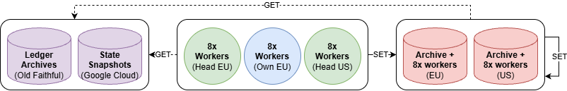

# Architecture

[Back to overview](../README.md)

## Goal

Provide historical account state and execution inputs from genesis to the latest
finalized block. This is the **planned production scope**, not current coverage
of the repository's demonstration.

Transaction archives preserve what transactions and blocks contain. Reconstructing
account state also requires a starting state, correctly matched execution rules,
automatic updates and the context needed at the requested transaction boundary.

## Backfill

  
   
  Figure 1 — Historical backfill

Verified writes to both copies. Worker counts are indicative.

The EU Dataforest primary and US WebNX replica each hold the complete historical
dataset; they are not disjoint calendar shards. The new plan replaces the earlier
two-Hetzner-plus-Artnet layout. Internal immutable segments still have shard IDs,
but adding a second complete copy does not double the logical-history estimate.
See the [2027 capacity and access plan](capacity-plan.md). The API/replay coordinator is
co-located on the storage hosts; PostgreSQL service metadata/jobs and bounded
RocksDB ingestion overlays do not form a third historical payload archive.
Consistent checkpoint/metadata exports are replicated, not live database files.

Our eight workers and spare storage/head compute replay independent ranges from
qualified starting checkpoints. The two TeraSwitch machines first help backfill,
then become non-voting capture nodes before the final backfill/live join. Worker
density is measured per machine, not inferred from RAM alone. No additional
temporary worker fleet is assumed. Capture retains native effects and finalization,
not merely third-party RPC subscriptions.

Dataforest also runs replay workers when CPU, RAM, scratch and serving load
permit. WebNX is not counted for replay without qualified scratch. Each producer seals output
once and sends the identical segments directly to both storage destinations.
Each site verifies checksums and records its own durable acknowledgement before
the coverage manifest marks that copy complete. Writes and retries are idempotent.
The EU archive is not a compulsory relay to the US archive.

## After backfill

  
   
  Figure 2 — Continuous sync and historical access

Independent heads update both copies; GET uses the API or download service.

Temporary worker allocations end after catch-up; the rented machines remain
funded for the year. Frankfurt and Newark heads independently capture finalized
changes. The capture pipeline reconciles boundaries, verifies and seals generations,
then writes directly to both copies. This coordination is co-located with the
existing hosts, not an extra server. Verified ranges can serve requests
during backfill. Start capture before the final backfill/live-state join and
retain overlap to verify the join; never treat a missing range as unchanged state.
Both heads share TeraSwitch and therefore do not provide head-provider independence.

## Planned machines

One dedicated machine per row; these are planned configurations, not deployed hosts.

| Provider / location | Type | CPU / RAM | Drives | Outgoing / month; port | Est. replay workers | Net price / month; year |
|---|---|---|---|---|---|---|
| TeraSwitch, Frankfurt | Head | EPYC 9354: 32C/64T; 512 GB DDR5 | 2x960 GB RAID1 boot; 2x3.84 TB NVMe | 150 TB; 2x25 Gbps | 4–8 | $920; $11,040 |
| TeraSwitch, Newark | Head | EPYC 9354: 32C/64T; 512 GB DDR5 | 2x960 GB RAID1 boot; 2x3.84 TB NVMe | 150 TB; 2x25 Gbps | 4–8 | $920; $11,040 (estimate) |
| Dataforest, Frankfurt | Storage | EPYC 7713: 64C/128T; 512 GB DDR4 ECC | 36x28 TB HDD; 2x4 TB NVMe | 250 TB; 2x10 Gbps | 6–8 | €1,531.48; €18,377.76 |
| WebNX, Ogden | Storage | 2x Xeon Bronze 3106: 16C/16T total; 384 GB DDR4 | 60x18 TB HDD; 480 GB SSD boot | 500 TB; 10 Gbps | 0–1 | $1,851; $22,212 |

Own cluster: **8 workers**; estimated backfill total **22–32**, excluding WebNX.
**Estimates, not benchmarks:** allow 8–16 CPU threads and approximately 40 GiB per
job, with CPU reserved for shared archive work. The RAM allowance combines the
retained native-replay and encoder ceilings; it is not a measured integrated job.
Scratch, source access, network and durable writes still need qualification.
The diagrams' counts are indicative, not equal-speed worker guarantees.
Heads first run backfill, then switch to native capture.

WebNX is the archive/download replica, not comparable backfill compute: it has
older low-clock CPUs and **no quoted NVMe scratch**. Its 0–1 estimate is a CPU
possibility only; **zero WebNX replay workers are counted toward completion**.
Dataforest supplies the materially stronger shared storage/compute configuration.
The [worker plan](../data/worker-plan-20261024.json) records the arithmetic and assumptions.

The head boot pair provides approximately 960 GB mirrored space, not 1.92 TB
of independent data storage; accounts and ledger use separate NVMe drives.

Budget heads at **$920/month each**, based on the configured Frankfurt machine;
Newark price/stock require confirmation. Each includes 150 TB/month outgoing,
not unmetered traffic. The two full storage copies have separate allowances:
250 TB/month EU and the purchased 500 TB/month US tier. See the
[capacity and access plan](capacity-plan.md) for limits and delivery handling.

## Build once, query many times

| Stage | Work | Output |
|---|---|---|
| Bootstrap | Verify genesis/snapshot identity and complete starting account inventory | Trusted state and native restart prerequisites |
| Import | Read archived ledger inputs and original metadata | Ordered, source-identified transactions and blocks |
| Execute | Use matching Solana/Agave runtimes; capture committed and automatic updates | Account changes and native context at defined boundaries |
| Pack | Deduplicate shared values; encode anchors/patches; compress and seal segments | Immutable history with compact temporal indexes |
| Serve | Resolve signature/cursor and predecessor versions; read bounded frames | Historical state or complete execution inputs |
| Maintain | Ingest finalized head, replicate, monitor and recover | Current, checked coverage |

Snapshots alone do not reveal all changes between them. The archived ledger is
executed once during ingestion to recover those changes. Later account-state
queries apply retained patches; they do not replay preceding transactions.
Simulating an original or modified transaction still requires executing that
transaction against the reconstructed state and correct runtime context.

## Storage and index roles

| Component | Role |
|---|---|
| Immutable Zstandard segments | Account/context changes, original wires/results, envelopes and receipts |
| Compact version indexes | Account + slot + transaction position → preceding stored version |
| Temporal membership indexes | Program owner, mint, token authority and delegate membership |
| Address postings | Address → ordered transaction IDs; reuse existing signature/transaction directory |
| RocksDB | Bounded mutable ingestion/catalogue overlays, not the entire payload archive |
| PostgreSQL | Service metadata, jobs and access management, not historical account blobs |
| NVMe/RAM | Explicitly bounded routing metadata, active ingestion and hot frame caches |
| HDD | Sealed history and cold indexes |

Use full anchors plus **directly referenced bounded patches**. Do not require an
unbounded walk from genesis for each account read. Route to the appropriate
shard/segment, find the predecessor, read its frame and reconstruct the bytes.
The main example uses one small compressed index/frame. A separate tested
pointer codec splits blocks at shard boundaries and preserves full cursor order.
Neither implements production global routing, the RocksDB overlay or the API.

## Historical request and replay paths

The directory resolves each preceding account version across local segments,
regardless of the target transaction's slot. Each site has a complete copy. Bulk indexes stay on
HDD with bounded hot routing pages on NVMe/RAM. Payload frames are read from HDD,
decompressed and patched in RAM. A state read or replay-input request returns
stored facts; a simulation additionally executes the requested transaction with
the matching runtime. It does not replay a slot prefix to rebuild captured state.

Discovery queries first select account IDs through temporal membership indexes;
large supply/ranking queries may need scans. The pictured path is not a latency
SLA for every planned RPC. [Architecture figures](diagrams/README.md) include
editable draw.io PNGs and retained earlier Mermaid/SVG variants.

## Why not a trie or ClickHouse everywhere?

A Patricia/Merkle trie does not automatically make version-history storage smaller.
The basic serving operation is an ordered predecessor lookup and bounded frame
read. Authenticated proofs would require a separate, explicitly defined design.

Small local tests supported the immutable index for historical lookups and
RocksDB for a mutable durable window, but cache/protocol conditions differed.
The current JSON-directory prototype was not the smallest stored index.
ClickHouse remains a possible downstream
analytics consumer; it is not required by the initial state-serving design.
See [the measured comparison](benchmarks.md#database-index-comparison).

## Publication, replication and recovery

1. Write and fsync account/context/input/result chunks.
2. Verify checksums, schemas, counts, boundaries and validation results.
3. Seal one consistent generation manifest after local verification.
4. Deliver identical sealed chunks and versioned manifests directly to both providers.
5. Verify and publish each destination; test restoration and corruption rejection.

A RocksDB transaction alone does not atomically commit external payload files.
RAID is not an independent replica or a versioned backup. Preserve source inputs
until capture completeness and recovery have been qualified.
Archive-to-archive replication remains a repair/catch-up path when producer
staging is no longer available; it is not required for every normal write.
The independent replica is also a planned **limited warm standby**: a running,
rate-limited API can serve account state and stored replay inputs through the
last completely verified checkpoint. Indexes, consistent manifests and service
metadata must be ready on the replica infrastructure; routing and access
controls must remain available if the primary provider is down.

M2 must test manual failover and failback, published coverage/lag and request
limits. Reject incomplete generations; do not report unreplicated head coverage.
Maintain versioned recovery copies independently of the standby service.
This is not instant or equal-throughput failover. The second independent capture
node is a separate part of the new plan, not a property of RAID or replication.
Write promotion and automatic failover are not included.
These are production deliverables, not capabilities demonstrated by the offline example.

## Public access and funded operations

- **Free:** All planned RPCs have a bounded allowance; shared compressed downloads
  and coverage manifests are available during funded hosting.
- **US traffic:** Reserve operations first within the WebNX 500 TB/month outgoing
  allowance; cap or queue free API/bulk usage before exhaustion. The port speed is
  not an unmetered entitlement. Confirm a no-overage cutoff before deployment.
- **Paid delivery:** Large prepaid exports use the EU site; cover additional
  outgoing transfer and preparation costs without charging those exports to the grant.
- **Txlab:** Larger quotas, replay/backtesting compute and custom processing can be
  paid services. All grant-funded code and formats remain public/open-source.
- **Support:** Nine funded maintenance months, April–December 2027. Review renewal
  or Foundation/operator handover by December 1; hosting ends December 31.

Handover requires a willing recipient and provider approval. The receiving operator
pays future costs; there is no indefinite unpaid support or custom-development promise.

## Explicit non-goals

* Recording private keys, private workspace mutations or unrecorded node gossip.
* Duplicating all account bodies inside every query index.
* A full global instruction/memory trace archive.
* A dependency manifest for every transaction: dependencies can be resolved from
  retained state/indexes, with a bounded on-demand cache.
* Claiming the minimal example is a complete historical Solana node.
