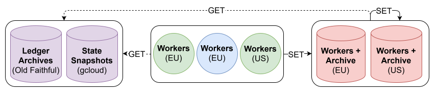
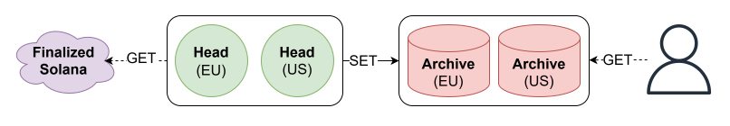

# Architecture & how it works

Planned production design, updated October 25, 2026; not the offline demo's current capabilities.

## 3.1. Historical backfill

- **Fetch:** Genesis, verified snapshots and free-access Old Faithful ledger inputs.
- **Reconstruct:** Our eight workers, both storage hosts and temporarily the head servers replay size-balanced ranges.
- **Store:** Workers write the same verified output directly to both complete EU/US copies.

  
   
  Figure 1 — Historical backfill

All workers fetch inputs and write verified output directly to both archives.

[Editable draw.io SVG](sol-hist-16px.drawio.svg)

The blue EU circle is our owned cluster. The green EU/US circles are workers on
the future head servers. Red **Workers + Archive** hosts combine a full history
copy with qualified replay compute. The upper GET arrow lets archive-local workers
fetch source inputs too; the right SET loop means those workers write directly to both
archives, not EU-to-US replication. Each worker seals verified output once and
sends identical segments to both destinations.

## 3.2. Continuous sync & historical access

- **Capture:** TeraSwitch Frankfurt and Newark run independent non-voting heads after their temporary worker phase.
- **Append:** Reconcile finalized boundaries, verify updates and write sealed history directly to both copies.
- **Serve:** Dataforest Frankfurt is the primary; BudgetVM Detroit holds a full copy and provides limited standby/API reads.

  
   
  Figure 2 — Continuous sync and historical access

Independent heads update both archives; users read through the API or download service.

[Editable draw.io SVG](sol-hist-16px-pt2.drawio.svg)

The same green hosts become **Head (EU/US)** after their worker phase. Each
captures finalized changes independently; verification reconciles overlapping
updates before idempotent writes reach both **Archive** destinations. The user
reads historical state or downloads through the service, not raw database access.

## Diagram notes

Both heads share TeraSwitch, so geographic diversity is not head-provider diversity.
This concentration risk is accepted: head compute is easier to replace than the
archives. TeraSwitch balances validator proximity, hardware and price; it is not
a claim of measured lowest latency. Storage providers remain independent.
Standby is manual and rate-limited at the last verified checkpoint, not instant
or equal-throughput failover. Capture starts before the final backfill/live join.
Archive-to-archive transfers are for repair or catch-up, not the normal write path.

GET/SET labels describe logical access, not a specific network protocol. GET arrows
point from requester to source; returned data travels in the opposite direction.
The API and verification software run on the existing hosts, not an extra server.
There are no worker counts in these figures: use the indicative, unbenchmarked
allocations in the [server plan](../architecture.md#planned-machines).
The two user-supplied SVGs use 16 px Arial labels and retain both editable draw.io
pages; open either SVG in app.diagrams.net and select Backfill or Live to edit it.
Vector outlines scale cleanly, with an export border around each figure.
Superseded PNG and smaller-font SVG exports have been removed from the active assets.

[Technical design](../architecture.md) · [Capacity and access](../capacity-plan.md)
